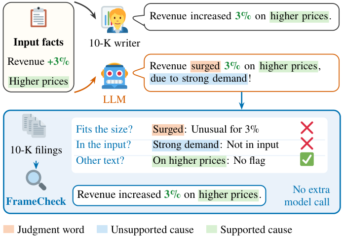
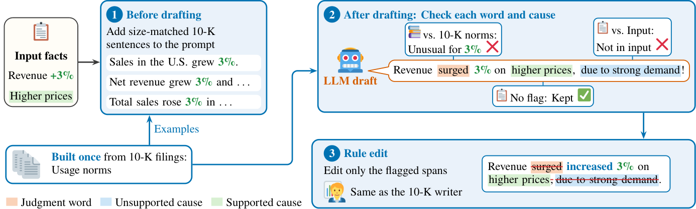

<div align="center">

# 🧾 FrameCheck

**Right numbers, wrong story? Keep LLM-drafted financial text within its input.**

*Code and data for the paper* **"Right Numbers, Wrong Story: When LLMs Narrate Financial Changes Beyond Their Inputs"** *(under review).*


</div>

---

## 💡 Why FrameCheck?

An LLM can state **every number correctly** and still **tell a different story**.
Given only *"Revenue +3%, higher prices"*, a model may write:

> Revenue **surged** 3% on higher prices, **due to strong demand**!

The number is right, so a fact check passes. But the draft adds two things that no input supports:

| | Span | Problem |
|---|---|---|
| 🟧 Judgment word | *surged* | 10-K writers use *surge* for changes of about 16% to 282%, not 3% |
| 🟦 Unsupported cause | *due to strong demand* | Nobody gave this cause |
| 🟩 Supported cause | *on higher prices* | In the input, so it is kept |

We call such additions **unsupported framing**. FrameCheck removes them and returns what a 10-K writer would have written:

> Revenue increased 3% on higher prices.

<p align="center"></p>

---

## 🔧 How it works

FrameCheck is a **plug-in between the LLM and human review**. It needs no training and no access to the model, and it makes **no model call after drafting**.

<p align="center"></p>

| Step | When | What it does |
|:---:|---|---|
| **1** | Before drafting | Adds six **size-matched 10-K sentences** of other firms to the prompt. Most of them carry no magnitude word, which shows the model how rarely writers judge a change. |
| **2** | After drafting | Checks each **judgment word** against its **usage norm**, the range of change sizes on which 10-K writers use it (10th to 90th percentile). Checks each **cause** against the input. |
| **3** | After drafting | **Edits only the flagged spans by rule**: cuts the unsupported cause, deletes a misfit adverb or adjective, and replaces a misfit verb with *increased* or *decreased*. The number is always kept. |

For pipelines that cannot hold retrieved sentences, **FrameCheck (style)** replaces Step 1 with one sentence: *"Follow the style of 10-K filings, which usually report a change with its number alone and rarely add words such as slightly or significantly."*

---

## 📦 Installation

```bash
git clone <this repository>
cd framecheck
pip install -r requirements.txt     # pandas, numpy (vllm only for drafting with open LLMs)
```

The usage norms and the retrieval pool (19,671 sentences of the reference firms, 0.6 MB) ship with the package.

---

## 🚀 Quickstart

```python
from framecheck import FrameCheck

fc = FrameCheck()                      # FrameCheck(style=True) for the lightweight variant
facts = "Revenue: +3%. Higher prices."
draft = "Revenue surged 3% on higher prices, due to strong demand."

# Step 1: the drafting prompt with size-matched 10-K sentences
prompt = fc.build_prompt("Revenue", 2020, 3.0)

# Step 2: flags for each judgment word and each cause
report = fc.check(draft, size=3.0, context=facts)

# Step 3: the rule edit (no model call)
print(fc.revise(draft, size=3.0, context=facts))
```

Running [`examples/quickstart.py`](examples/quickstart.py) prints:

```text
Sentences from other companies' 10-K filings that describe changes of a similar size:
- "General and administrative costs increased 3% in 2013 compared to 2012 and were flat in 2012 compared to 2011."
- "Excluding unfavorable exchange movements, sales increased 3%."
- "Retail electric kilowatthour sales increased 3 percent in 1995."
- "The number of new members joining increased 3% during 2003 compared with 2002, with no change at same clubs."
- "Policy claims and benefits payable increased 3% in 1996 compared to 1995."
- "ATM transactions increased 3% year over year."

Line item: Revenue
Period: fiscal 2020 compared with fiscal 2019
Change: +3.0%

Write one sentence describing this change for the Management's Discussion and Analysis (MD&A) section of the company's annual report on Form 10-K. Reply with the sentence only.
------------------------------------------------------------
word  v:surge    class=intense  norm=16-282.35%  flag=inflated
cause 'due to strong demand'  support=0.0  supported=False
------------------------------------------------------------
Draft:      Revenue surged 3% on higher prices, due to strong demand.
FrameCheck: Revenue increased 3% on higher prices.
Kept:       Revenue increased significantly by 45%.
Supported:  Revenue increased 3%, driven by higher prices.
```

Words that fit the size of the change are kept, and so are causes that the input gives (`context`).
Without a `context`, every cause counts as unsupported, because the input gives only the number.

---

## 📊 Reproducing the main results

We release the drafts of **17 open LLMs** (7B to 72B) for the main conditions, so the main table can be reproduced **on a CPU in about 20 seconds**:

```bash
python scripts/evaluate.py
```

```text
10-K writers: Judged 1.5
                     Judged  Misfit  Cause  Placeholder  Invented  Number    Gap  Models
Plain prompt           17.2     0.4   77.0          8.5       0.9    98.0  101.2      17
+ Norm card            80.0    15.9    9.7          0.6       0.3    88.8   88.8      17
+ Style instruction     0.1     0.0    5.3          3.1       2.3    99.8    9.8      17
FrameCheck              1.0     0.0    0.4          0.2       0.1    99.8    1.1      17
FrameCheck (style)      0.0     0.0    0.4          2.7       2.3    99.8    4.5      17
```

All values are shares of drafts (%), averaged per model first and then over the 17 models.

| Metric | Meaning | Best |
|---|---|:---:|
| **Judged** | The draft judges the change with a mild, moderate, or intense magnitude word | ≈ writers (1.5) |
| **Misfit** | A magnitude word falls outside its usage norm | ↓ |
| **Cause** | The draft adds a cause (the input gives none) | ↓ |
| **Placeholder** | A slot such as `[reason]` or `$X` | ↓ |
| **Invented** | An amount that the input does not give | ↓ |
| **Number** | The size of the change is stated as given | ↑ |
| **Gap** | \|Judged − 1.5\| + Cause + Placeholder | ↓ |

To draft with your own model (GPU and [vLLM](https://github.com/vllm-project/vllm) required):

```bash
python scripts/draft.py Qwen/Qwen2.5-7B-Instruct qwen25-7b      # writes data/drafts/draft_qwen25-7b.jsonl
python scripts/evaluate.py --drafts data/drafts/draft_qwen25-7b.jsonl
```

---

## 🗂️ Data

| File | Content |
|---|---|
| `data/draft_items.jsonl` | 980 line-item changes from the **test firms**, stratified by size and direction, with the writer's own 10-K sentence |
| `data/drafts/drafts_main.jsonl.gz` | 4 drafts per item × 5 conditions × 17 LLMs (83,300 rows) |
| `framecheck/resources/norms.tsv` | Usage norms per magnitude word (quantiles of the change size in %) |
| `framecheck/resources/norms_class.tsv` | Norms per class (mild / moderate / intense) for rare words |
| `framecheck/resources/retrieval_pool.jsonl.gz` | Sentences of the **reference firms** for size-matched retrieval |

All text comes from the MD&A sections of 10-K filings in [EDGAR-CORPUS](https://huggingface.co/datasets/eloukas/edgar-corpus), which are public filings of the US SEC.
Firms are split once into **reference firms (70%)**, which build the norms and the retrieval pool, and **test firms (30%)**, which supply every evaluation item.

To rebuild the norms from scratch:

```bash
# 1. put EDGAR-CORPUS as JSON lines (fields: filename, cik, year, section_7) under data/raw/<year>/
python scripts/extract_pairs.py data/pairs.jsonl --glob 'data/raw/*/*.jsonl'   # (magnitude word, change size) pairs
python scripts/build_norms.py data/pairs.jsonl --out framecheck/resources        # reference firms only
```

---

## 🧱 Repository layout

```text
framecheck/
├── framecheck/
│   ├── pipeline.py      # FrameCheck: build_prompt (step 1), check (step 2), revise (step 3)
│   ├── lexicon.py       # 78 forms of magnitude words: adverbs, adjectives on a change noun, verbs
│   ├── norms.py         # usage norms and the inflated / deflated flag
│   ├── retrieval.py     # size-matched retrieval of 10-K sentences
│   ├── support.py       # lexical support of a cause by the input
│   ├── edit.py          # rule edit: cut a cause clause, delete or replace a word
│   ├── prompts.py       # prompts used in the experiments
│   ├── metrics.py       # metrics of the paper
│   └── resources/       # norms and retrieval pool
├── scripts/
│   ├── draft.py         # drafting with open LLMs (vLLM)
│   ├── evaluate.py      # main results
│   ├── extract_pairs.py # pairs of magnitude words and change sizes from 10-K text
│   └── build_norms.py   # usage norms from the reference firms
├── data/                # test items and released drafts
├── examples/quickstart.py
└── tests/test_basic.py
```

---

## ⚠️ Scope

- The norms describe how **10-K writers** use magnitude words in US filings in English. Other markets, languages, or genres may use them differently.
- A flag marks a word **for review**, not an error: by definition, one in ten writer uses falls outside a range.
- The cause check relies on a list of causal connectives and can miss causes introduced in other ways.
- FrameCheck is meant to **support human review** of financial text, not to replace the people who sign it.

---

## 📝 Citation

```bibtex
@misc{framecheck2026,
  title  = {Right Numbers, Wrong Story: When LLMs Narrate Financial Changes Beyond Their Inputs},
  author = {Anonymous},
  year   = {2026},
  note   = {Under review}
}
```

## 📄 License

Code is released under the [MIT License](LICENSE). The 10-K text comes from public SEC filings via EDGAR-CORPUS; please also follow the terms of that dataset.
